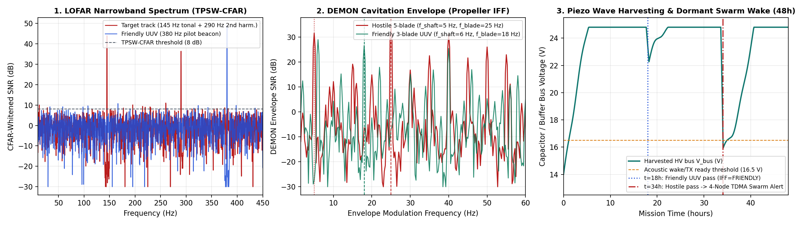

# PELAGOS — Deniz Tabanı Pasif Akustik Sınıflandırma, Piezo Enerji Hasadı ve Sürü (Swarm) Düğümü

[](https://github.com/eerdemgundogdu/pelagos-acoustic-node/actions/workflows/checks.yml)
[](https://github.com/eerdemgundogdu/pelagos-acoustic-node/actions/workflows/hardware.yml)

Deniz tabanında uzun süreli uyku modunda (`dormant`) bekleyerek dip akıntısı ve dalga salınımlarından **piezoelektrik (PVDF/PZT) enerji hasadı** yapan, hidrofon üzerinden aldığı su altı akustik sinyallerini **gerçek zamanlı LOFAR ve DEMON (Detection of Envelope Modulation on Noise) FFT** algoritmalarıyla işleyerek araçların pervane/şaft akustik imzasından dost-düşman (`IFF`) ayrımı gerçekleştiren ve komşu düğümlerle **su altı ultrasonik BFSK/TDMA sürü (swarm) ağı** üzerinden haberleşen gömülü sistem ve donanım projesi.

> **Açık Kaynak Kapsam Notu:** Bu depo, tek gömülü yazılım/donanım geliştiricisi olarak yürütülen su altı akustik düğüm çalışmasının yalnızca **2 katmanlı AFE/güç PCB tasarımını (`hardware/`)**, **C++17 sabit/kayan noktalı LOFAR-DEMON FFT ve TPSW-CFAR sinyal işleme çekirdeğini (`firmware/`)** ve **anahtarlı MAC doğrulamalı akustik sürü yönlendirme katmanını** içerir. Saha hidrofon kalibrasyon tabloları, gerçek platformlara ait akustik hedef imza kütüphaneleri ve birincil görev/eyleyici tetikleme mantığı açık kaynak sürümünden çıkarılmış; doğrulama testlerinde sentetik 3-kanatlı (Dost UUV) ve 5-kanatlı (Hedef İz) kavitasyon profilleri kullanılmıştır.

---

## 1. Pasif Sonar Sinyal İşleme (LOFAR / DEMON) ve Piezo Enerji Hasadı



Su altında akustik imza sınıflandırması iki tamamlayıcı spektral hat üzerinden yürütülür:

1. **LOFAR (Low-Frequency Analysis and Recording) & TPSW-CFAR Beyazlatma:**
   - Deniz ortamının $1/f$ (Knudsen) arka plan gürültüsü, **Two-Pass Split-Window (TPSW) CFAR** algoritmasıyla yerel gürültü tabanına bölünerek beyazlatılır; böylece sabit yanlış alarm oranıyla dar-bant makine, redüktör ve akustik pilot tonalleri ($10\text{ Hz} - 450\text{ Hz}$) tespit edilir.
2. **DEMON (Detection of Envelope Modulation on Noise) Pervane/Şaft Analizi:**
   - Pervane kanat uçlarındaki kavitasyon gürültüsü yüksek frekanslı taşıyıcı bandında şaft devri ($f_{\text{shaft}} = \text{RPM}/60$) ve kanat geçiş frekansı ($f_{\text{blade}} = N_{\text{blades}} \cdot f_{\text{shaft}}$) ile genlik modülasyonuna uğrar.
   - Yüksek geçiren filtre + tam dalga doğrultma + $4\times / 8\times$ desimasyon + Hanning pencereli Radix-2 FFT zinciriyle zarf spektrumu çıkarılır; $N_{\text{blades}} = \text{round}(f_{\text{blade}} / f_{\text{shaft}})$ oranından platformun pervane kanat sayısı ve sınıfı (`IFF_FRIENDLY_UUV` vs. `IFF_HOSTILE_TRACK`) belirlenir.
3. **Piezoelektrik Dalga / Akıntı (VIV) Enerji Hasadı ve Uyku Durum Makinesi (`PiezoHarvesterFSM`):**
   - Düğüm, $V_{\text{bus}} < 16.5\text{ V}$ iken `< 15 µA` derin uyku (`STATE_DEEP_SLEEP_HARVEST`) modunda kalarak piezoelektrik doğrultucudan gelen gücü kapasitör/batarya bankasında biriktirir.
   - Yalnızca pasif akustik eşik aşıldığında (`STATE_PASSIVE_LISTEN` → `STATE_DSP_CLASSIFY`) Cortex-M7 çekirdeği DMA tamponunu işler; hedef doğrulandığında (`STATE_SWARM_TX_ALERT`) komşu düğümleri uyandırmak üzere TDMA diliminde akustik paket yayınlar.

---

## 2. 2 Katmanlı KiCad AFE, Enerji Hasadı ve Sürü Modem Kartı (`hardware/`)


`hardware/gen/design.py` içindeki tek kaynaklı netlist'ten hem şematik hem de **110 × 85 mm, 2 katmanlı PCB** otomatik üretilir ve KiCad 9 DRC/ERC + şematik-PCB parite kontrolünden **0 hata, 0 bağlanmamış pad** ile geçer:

- **Piezo Hasat & HV Koruma Katı (`J1`, `F1`, `D1`, `D2`, `C1`):** 1 A PTC sigorta, `SS16` ters polarite/geri akım engelleme diyodu, `SMBJ30CA` (600 W) çift yönlü TVS ve $47\ \mu\text{F}$ enerji depolama bankası.
- **Anahtarlamalı + Düşük Gürültülü AFE Beslemesi (`U1`, `U2`):** `LMR16006X` (700 kHz, 5 V buck) + `AP2112K-3.3` düşük gürültülü analog/sensör LDO'su + `B5819W` geri besleme izolasyonu.
- **Hidrofon Analog Ön-Ucu (`J2`, `R21`, `R22`, `C11`, `D6`):** $f_c \approx 318\text{ Hz}$ RC anti-aliasing alçak geçiren filtre ve yakın akustik şoklara karşı `BAT54S` çift seri Schottky ADC klempi (`Pin 16 / A2`).
- **6× Akustik Dizi / Ultrasonik BFSK Modem Çıkışı (`J5..J10`):** `220 Ω` seri empedans eşleme ve derin uykuda sızıntıyı önleyen `100 kΩ` pull-down dirençleri (`CH4/CH5`: $24\text{ kHz} / 28\text{ kHz}$ BFSK akustik modem taşıyıcısı).
- **Donanımsal Manyetik Kurma/Emniyet Anahtarı (`J11`) ve Kontaktör (`J12`, `Q2`):** Su geçirmez NC manyetik reed anahtar kontaktör bobiniyle seri bağlıdır; emniyet mıknatısı takılıyken yüksek güçlü çıkış yazılımdan bağımsız olarak enerjilenemez.

Detaylı devre hesapları için [`hardware/DESIGN.md`](hardware/DESIGN.md), konnektör pinleri için [`hardware/WIRING.md`](hardware/WIRING.md) ve Gerber/BOM/CPL üretim dosyaları için [`hardware/output/`](hardware/output/) dizinine bakabilirsiniz.

---

## 3. Akustik Sürü (Swarm) TDMA/BFSK Protokolü (`firmware/src/swarm_mesh.cpp`)

Su altı akustik kanalının düşük bant genişliği ve çoklu-yol (multipath) yankılarına karşı 16 baytlık kompakt çerçeve yapısı kullanılır:

| Bayt | Alan | Açıklama |
|---|---|---|
| `0..1` | `0xA5, 0x5A` | Akustik senkronizasyon önsözü (preamble) |
| `2` | `src_node_id` | Kaynak düğüm kimliği (`1..254`) |
| `3` | `seq_num` | Paket sıra numarası (tekrarlı paket engelleme için) |
| `4..5` | `hop_count`, `ttl` | Geçilen atlama sayısı ve kalan maksimum atlama (Time-To-Live) |
| `6..7` | `iff_class`, `blade_count` | Sınıflandırılan hedef tipi ve DEMON pervane kanat sayısı |
| `8..9` | `lofar_hz_q2` | Dominant LOFAR frekansı ($0.25\text{ Hz}$ çözünürlük) |
| `10..11` | `snr_db_q2`, `soc_pct` | CFAR SNR ($0.25\text{ dB}$) ve düğüm enerji doluluk oranı (`%`) |
| `12..13` | `mac16` | Akustik sahteciliği (spoofing) önleyen 16-bit anahtarlı FNV-1a doğrulama etiketi |
| `14..15` | `crc16_ccitt` | CRC-16-CCITT (`0x1021`) bütünlük kontrolü |

---

## 4. Derleme ve Testler

```bash
# 1. C++17 Gömülü DSP, DEMON IFF, Sürü Mesh ve Piezo FSM birim testleri
cmake -S firmware/test -B build/test
cmake --build build/test
ctest --test-dir build/test --output-on-failure

# 2. Python LOFAR/DEMON ve 48 saatlik Piezo Hasat / Sürü benzetim testleri
python3 dsp/test_acoustic_pipeline.py
python3 dsp/plot_acoustic_mission.py

# 3. Cortex-M7 / Teensy 4.1 hedef firmware derlemesi (PlatformIO)
pio run -d firmware -e teensy41_acoustic_node
```
