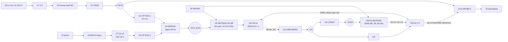

# Tasarım notları — Akustik sürü düğümü (acoustic-swarm-node) Rev A

> **Durum: Rev A, tasarım aşamasında. Kart henüz üretilmedi ve hiçbir parçası donanımda test edilmedi.** Aşağıdaki değerler datasheet'lerden ve hesaptan gelir; ölçülmüş değer değildir. Hesapların çoğu `dsp/node_model.py` içinde bileşen değerleri doğrudan `hardware/gen/design.py`'den okunarak tekrar yapılır ve `dsp/test_node_model.py` ile firmware sabitlerine karşı test edilir.

## 1. Düğüm ne yapıyor?

Deniz tabanına bırakılan, aylarca pille bekleyen pasif akustik dinleme düğümü:

1. **Uykuda** yalnızca birkaç µA çeken analog bir uyanma devresi hidrofonu dinler. Teensy, AFE ve modem tamamen enerjisizdir.
2. Gemi/araç gürültüsü (20–450 Hz bandında) eşiği aşınca karşılaştırıcı 5 V buck'ı açar. Teensy açılır ve `PWR_HOLD` ile kendi beslemesini tutar.
3. Teensy, hidrofonu 192 kHz'de iki kazançla örnekler. **LOFAR** ile dar bant makine tonlarını, **DEMON** ile pervane şaft ve kanat geçiş frekanslarını çıkarır ve basit bir IFF kuralıyla sınıflandırır.
4. Hedef bulunursa 24/28 kHz **BFSK** akustik modemle (1 kbps, TDMA yuvası, SipHash etiketli) komşu düğümlere alarm yayınlar; komşular TTL bitene kadar paketi aktarır.
5. Dinleme penceresi aktivitesiz dolunca `PWR_HOLD` bırakılır, kart tekrar uykuya döner.

Piezo dalga/akıntı elemanından gelen enerji, hep açık alanı besleyerek uyku akımını pilden alır.

| Sorun | Karttaki çözüm |
|-------|----------------|
| Teensy 4.1 en derin uykuda bile mA mertebesinde çeker; aylarca beklemek imkânsız | Teensy'nin beslemesi tamamen kesilir. Uyanma kararını ~7 µA'lik analog bir zincir verir (`U3` MCP6042 + `U4` TLV7031), buck'ı `BUCK_EN` ile açar |
| Pasif sonar sinyalleri µV mertebesinde, kendi modem yayınımız ise V mertebesinde | İki kazançlı AFE: 20 dB (`AFE_LO`) ve 40 dB (`AFE_HI`) çıkışları Teensy'nin iki ADC'sinde aynı anda örneklenir; firmware kırpılmayan kanalı seçer (~80 dB dinamik aralık). Yayın sırasında alıcı susturulur |
| 192 kHz örneklemede 96 kHz üstü enerji bant içine katlanır | 2. derece Sallen-Key (fc 39.7 kHz) + 2. kademede 65 kHz kutbu: 152 kHz'te (40 kHz'e katlanan) −31 dB; dijital desimasyon filtreleri geri kalanı bastırır |
| Pil bölücüsü uykuda bile akım çeker (100k+15k → 130 µA) | `Q1`/`Q2` yüksek taraf anahtarı: bölücü yalnızca ölçüm anında bağlanır |
| Taşıma ve depolama sırasında kartın kendiliğinden uyanması | Seri NC reed kurma anahtarı (`J2`): taşıma mıknatısı takılıyken pil tamamen ayrık |
| Kendi akustik yayınımızın tüketimi | `DRV8871` H-köprüsü `IN1=IN2=0` iken ~1 ms sonra uykuya girer (< 1 µA); ayrı bir güç anahtarı gerekmez |

## 2. Blok şema

## 3. Güç girişi ve koruma

- **Pil:** 4S Li-ion paket, kendi BMS'i ile (12.0 V kesme, 16.8 V tam dolu). Kart üstünde yazılımsal kesme `12.4 V`'tur (`PowerConfig::batt_cutoff_v`).
- **F1 — 2 A, 63 V (1206).** Tepe yük modem yayınıdır (`DRV8871` akım sınırı ~1 A) + uyanık lojik (~40 mA @ 14.8 V).
- **J2 — kurma reed anahtarı.** Sigortadan sonra, her şeyden önce seri. Taşıma mıknatısı takılıyken kart sıfır akım çeker; denize indirmeden önce mıknatıs çıkarılır.
- **D1 — SS26 (60 V, 2 A) ters kutup.** 2 A'de ~0.5 V düşüm; uyanıkken ~40 mA'de ihmal edilebilir.
- **D2 — SMBJ20CA.** `Vrwm = 20 V` > 16.8 V; transdüser/kablo kaynaklı geri tepmeleri kıskaçlar. `C1` (47 µF/35 V) + `C2`, `C3` (2.2 µF/50 V X7R) toplu kapasite.

## 4. Hep açık alan (`+3V3_AON`) ve uyku akımı

`U1` (HT7533-1) pilden, `U2` (HT7533-1) piezo depolamasından 3.3 V üretir; `D4` (BAT54C) ortak katot diyot-VEYA'sı hangisi yüksekse onu kullanır. HT7533-1 seçildi çünkü 30 V'a kadar giriş kabul eden ve sükunet akımı 2.5 µA olan nadir LDO'lardan biri.

| Kalem | Akım | Kaynak |
|-------|------|--------|
| `U1` HT7533-1 sükunet | 2.50 µA | Holtek datasheet |
| `U3` MCP6042 (2 kanal) | 1.20 µA | Microchip datasheet (600 nA/kanal) |
| `U4` TLV7031 | 0.34 µA | TI datasheet |
| `R9`+`R10` Vref bölücü (2×10 MΩ) | 0.17 µA | 3.3 V / 20 MΩ |
| `R17`+`R18` eşik bölücü (4.7+5.1 MΩ) | 0.34 µA | 3.3 V / 9.8 MΩ |
| `R16` zarf boşaltma (dinlenmede ~1.4 V) | 0.30 µA | |
| `U5` LMR16006 kapalı (`EN` düşük) | ~1 µA | TI datasheet |
| `U10` DRV8871 uyku | ~1 µA | TI datasheet |
| **Toplam (pilden)** | **~6.8 µA** | `node_model.aon_budget()` |

3.4 Ah'lik bir pakette günde 10 dakika uyanık kalma (~0.55 W) varsayımıyla **~456 gün** (`node_model.battery_life_days()`). Uyanık güç tüketimi uyku akımına göre baskındır; günlük uyanma süresi pil ömrünü belirler.

## 5. Piezo hasadı

- `D14`, `D15` (BAT54S seri çiftleri) tam dalga köprü kurar; AC piezo çıkışı `C7`'yi (22 µF/25 V) doldurur. `D16` (BZT52C18) depolamayı 18 V'ta kıskaçlar: `C7` 25 V ve BAT54 30 V sınırlarının altında kalır.
- `U2` depolama ~3.5 V'u geçince regüle eder. `V_HARV`, `D4` üzerinden AON alanını besler; o sırada `U1`'den akım çekilmez (yalnızca kendi sükuneti).
- `R44` (1 MΩ), hasat yokken `V_HARV`'ı sıfırda tutar; böylece `D4`'ün ters kaçağı Teensy'nin `T_HARV_PG` (pin 12) girişinde yanlış "hasat var" okumasına yol açmaz.
- **Neden doğrusal regülatör?** Hasadın taşıdığı yük yalnızca ~7 µA × 3.3 V ≈ 23 µW. 10 V depolamadan doğrusal düşürmede verim ~%33 olsa da gereken giriş gücü ~70 µW'tır ve küçük bir PVDF şerit dalga hareketinde bunu sağlar. Buck tabanlı `LTC3588-1` verimi yükseltir ama 0.5 mm aralıklı MSOP/DFN kılıf gerektirir. Rev A'da elle lehimlenebilirlik ve yönlendirme için bütün yarı iletkenler ≥ 0.95 mm aralıklıdır. Rev B'de `LTC3588-1`'e geçilmesi planlanıyor.

## 6. Pasif akustik uyanma

- **Bias:** `R9`/`R10` (2×10 MΩ) + `C12` → `VREF_W = 1.65 V`. Giriş: `C13` (100 nF C0G) kuplaj, `R11` (10 MΩ) bias.
- **Kazanç:** Her kademe `1 + R12/R13 = 1 + 1M/33k = 31.3` (29.9 dB), toplam **59.8 dB**. MCP6042'nin GBW'si 14 kHz olduğundan kademe bandı ~450 Hz'dir. Bu bilinçli bir seçim: gemi gürültüsünün en güçlü olduğu 20–450 Hz bandı geçer, yüksek frekanslı biyolojik gürültü (karides çıtırtısı) zayıflar. `R13`/`C14` kazanç bacağındaki kondansatör DC kazancı 1'de tutar (HP kutbu 4.8 Hz).
- **Zarf:** `D5` (BAT54WS) + `C17` (470 nF) tepe dedektörü, `R16` (4.7 MΩ) ile τ = 2.2 s boşalır.
- **Eşik:** `R17`/`R18` (4.7/5.1 MΩ) → 1.717 V, yani `VREF_W`'nin 67 mV üstü. Zarf dinlenmede `VREF − Vf ≈ 1.45 V`'tadır; çıkışta ~0.3 V tepe (hidrofon girişinde ~0.3 mV tepe) karşılaştırıcıyı tetikler. Saha gürültü seviyesine göre `R18` değiştirilerek ayarlanır.
- **Mandal:** `WAKE_CMP` ve `T_PWR_HOLD`, `D6` (BAT54C) ile VEYA'lanır. `R20`/`C20` (1 MΩ/1 µF, τ = 1 s) karşılaştırıcı darbesini Teensy açılışına (~0.4 s) kadar uzatır. LMR16006'nın `EN` eşiği (~1.2 V), diyot sonrası ~3 V ile rahat aşılır.

## 7. 5 V buck ve analog besleme

- **U5 — LMR16006X** (700 kHz, 0.6 A). Stingray taşıyıcı kartıyla aynı topoloji: `Vout = 0.765 × (1 + 54.9k/10k) = 4.97 V`, `L1` 22 µH, `D7` SS16 serbest geçiş. Uyanık yük: Teensy ~100 mA + AFE ~3 mA + LED'ler.
- **U6 — LP5907-3.3** (6.5 µVrms). Yalnızca AFE ve sızıntı probunu besler; Teensy'nin dijital 3.3 V'u AFE referansına karışmaz.

## 8. Hidrofon AFE

| Kademe | Eleman | Değer |
|--------|--------|-------|
| Giriş kuplajı | `C28` 100 nF C0G, `R28` 10 MΩ | HP < 0.2 Hz (piezo eleman kapasitesiyle birlikte) |
| Koruma | `R27` 1 kΩ + `D10` BAT54S | `+3V3A`/`GND`'ye kıskaç |
| `U8A` ön yükselteç | `1 + R29/R30 = 1 + 9.1k/1k` | **10.1 (20.1 dB)**, `R30`/`C29` HP 15.9 Hz |
| `U8B` Sallen-Key LP | `R31`=`R32`=2.7 kΩ, `C30` 2.2 nF, `C31` 1 nF | **fc 39.7 kHz, Q 0.742** → `AFE_LO` |
| `U9A` ikinci kademe | `1 + R33/R34`, `C33` 270 pF | **10.1**, kutup 64.8 kHz → `AFE_HI` (toplam 40.2 dB) |
| `U9B` | Vref tamponu, `R26` 49.9 Ω izolasyon + `C27` 10 µF | `VREF_A = 1.65 V` |
| ADC sürme | `R35`/`R36` 100 Ω + `C36`/`C37` 2.2 nF C0G + `D11`/`D12` | τ = 0.22 µs; 9τ = 2 µs < 5.2 µs örnek periyodu |

`AFE_HI` frekans yanıtı (`node_model.afe_model().response`): 1 kHz'te 0 dB, 24 kHz'te −0.8 dB, 28 kHz'te −1.4 dB, 40 kHz'te −4.1 dB, 96 kHz'te −20.3 dB, 152 kHz'te −31.4 dB.

- **Op-amp:** MCP6022 (10 MHz GBW, 8.7 nV/√Hz, RRIO, 5.5 V). 20 dB kazançta bant ~1 MHz; 40 kHz'te ihmal edilebilir faz/kazanç hatası.
- **Dinamik aralık:** HI kanal ±1.65 V / 102 = ±16 mV giriş, LSB 7.9 µV. LO kanal ±163 mV. 12 bit ADC'nin ~66 dB'lik aralığına 20 dB kanal ayrımı eklenir.
- Firmware `DualGainSelector` kazanç sabitleri (`kGainLo = 10.1`, `kGainHi = 102.01`) bu değerlerle testte eşleştirilir.

## 9. Akustik modem vericisi

- **U10 — DRV8871** (HTSOP-8, 6.5–45 V, PWM ≤ 200 kHz). `IN1` = Teensy pin 6 (FlexPWM2.2A), sembol başına 24 veya 28 kHz %50 kare dalga. `IN2` = pin 9, normalde LOW: yarım köprü modu. `OUT1` 0↔VSYS arasında anahtarlanır, `C40` (2.2 µF/50 V) DC bileşeni keser.
- **Akım sınırı:** `R39` = 62 kΩ → `I_TRIP ≈ 64 / 62 = 1.03 A`.
- **Kart dışı:** 1:5 eşleştirme trafosu + ~25 kHz rezonanslı seramik projektör. Trafo ve projektör kablo ucundaki kılıf içindedir; `J5` yalnızca trafo primerini sürer.

### Bağlantı bütçesi (tahmini)

| Terim | Değer | Varsayım |
|-------|-------|----------|
| Kaynak seviyesi SL | 164 dB re 1 µPa @ 1 m | TVR 130 dB re 1 µPa/V, 50 Vrms sürme |
| Gürültü NL | 70 dB | Deniz durumu 2, 26 kHz'te 40 dB re 1 µPa²/Hz (Wenz), 1 kHz Goertzel bandı |
| Soğurma | 6.53 dB/km | Thorp, 26 kHz |
| Gereken SNR | 10 dB | `BfskDemodulator` 4× enerji kapısı + CRC |
| **Menzil** | **~2.5 km** | Küresel yayılma, çok yollu yayılım ihmal |

Sığ suda çok yollu yayılım menzili kısaltır; TDMA yuvası (250 ms > 176 ms çerçeve) yankı kuyruğuna 74 ms pay bırakır.

## 10. PCB kuralları ve yerleşim

- 2 katman, 120×95 mm, FR-4 1.6 mm, 1 oz. İz/boşluk 0.25/0.2 mm, via 0.6/0.3 mm. Her iki katmanda GND dökümü + 4 mm aralıklı GND dikiş via'ları.
- **Bölgeler:** Sağ üstte pil girişi, buck ve uyanma mandalı; sağ ortada AFE (Teensy'nin ADC pinleri 16/17'nin yanında); sağ altta uyanma devresi (`J4`'e yakın; 10 MΩ'luk yüksek empedanslı girişler kısa); sol üstte piezo hasadı, sol ortada hep açık LDO ve diyot-VEYA; sol altta H-köprüsü. Anahtarlamalı akım AFE'den en uzak köşede kalır, alt kenardaki 10 mm şerit kart boyu güç ve sinyal hatları için koridordur.
- **Pin ataması:** Her işlev, kartta yerleştiği taraftaki Teensy sırasına atanmıştır (sol: modem PWM ve hasat durumu; sağ: güç, AFE, uyanma); iki sıra arasından iz geçmez.
- Yönlendirme `gen/router.py` ile yapılır, sonra KiCad DRC çalıştırılır (`output/drc_report.txt`). CI her push'ta KiCad 9 ile ERC ve şematik paritesi dahil DRC çalıştırır.

## 11. Bilinen sınırlar ve Rev B

- Hidrofon hassasiyeti, uyanma eşiği ve IFF kuralları sentetik sinyallerle doğrulandı; saha kalibrasyonu yapılmadı. IFF kural seti bir demo'dur, gerçek bir imza kütüphanesi değildir.
- `IN2` ile tümleyen PWM (tam köprü) kaynak seviyesini +6 dB artırır; FlexPWM kayıtlarıyla yapılması Rev B'ye bırakıldı.
- Mesh çerçevesinde zaman damgası yok; tekrar oynatma koruması 16 girdilik (kaynak, sıra) halkasıyla sınırlı.
- `LTC3588-1` buck hasadı (bkz. bölüm 5) ve uyanma eşiğinin firmware'den ayarlanabilmesi (dijital potansiyometre).

## 12. Devreye alma sırası (üretimden sonra)

1. Teensy takılmadan, akım sınırlı (50 mA) güç kaynağıyla 14.8 V ver. Uyku akımı < 10 µA, `TP5` (`+3V3_AON`) ≈ 3.0–3.3 V, `TP2` (+5V) = 0 V olmalı.
2. `TP5`'ten sonra hidrofona tıklama ver: `TP2`'de ~1 s boyunca 5 V görülmeli (mandal).
3. `TP6` (`VREF_A`) = 1.65 V ± 20 mV; `AFE_LO`/`AFE_HI` sessizde 1.65 V civarında.
4. Teensy'yi tak, `pio run -e bench -t upload`, seri portta pil gerilimi ve LOFAR/DEMON çıktısını kontrol et.
5. Transdüser yerine 10 Ω/5 W yük ile `J5` çıkışında 24/28 kHz dalga şeklini osiloskopla doğrula.
