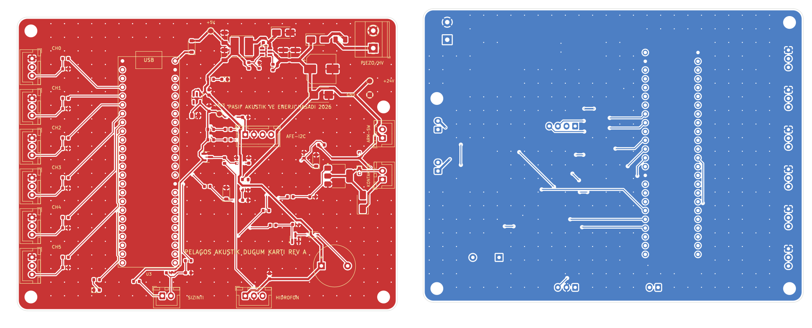

# Pelagos Deniz Tabanı Akustik Düğümü — 2 Katmanlı Taşıyıcı ve AFE Kartı (Rev A)



Bu dizin, otonom deniz tabanı pasif akustik sınıflandırma (LOFAR / DEMON), piezoelektrik dalga/akıntı enerji hasadı ve akustik sürü (swarm) haberleşme düğümü için geliştirilen **110 × 85 mm, 2 katmanlı (FR-4, 1.6 mm, 1 oz Cu)** elektronik kartın tek kaynaklı (`single-source netlist`) tasarımını ve üretime hazır çıktılarını içerir.

> **Güvenlik ve Açık Kaynak Kapsam Notu:** Bu depodaki donanım dosyaları yalnızca sivil/akademik su altı akustik sinyal işleme ön-ucunu (AFE), enerji hasadı güç katını ve genel amaçlı sürü (swarm) transdüser/eyleyici sürücü arayüzünü kapsar. Görev özelindeki akustik hedef imza şablonları, saha hidrofon kalibrasyon eğrileri ve birincil eyleyici tetikleme donanımı açık kaynak sürümünden çıkarılmıştır.

---

## Temel Özellikler

| Alt Sistem | Donanım Çözümü | Mühendislik Özelliği |
|---|---|---|
| **Piezo Hasat & HV Giriş (`J1`)** | `F1` (1 A PTC), `D1` (`SS16`), `D2` (`SMBJ30CA` TVS), `C1` (47 µF) | Dalga / girdap kaynaklı titreşim (VIV) piezo doğrultucu ve tampon batarya bara koruması |
| **5 V Anahtarlamalı Regülatör (`U1`)** | `TI LMR16006XDDCR` (700 kHz, SOT-23-6), `L1` (22 µH) | Geniş giriş aralığı (6–30 V), yüksek verimli step-down regülasyon |
| **3.3 V Düşük Gürültülü AFE LDO (`U2`)** | `Diodes AP2112K-3.3` + `D4` (`B5819W` USB/VIN izolasyonu) | Hidrofon ön-ucu ve MEMS akustik dizi için düşük ripple analog besleme |
| **Hidrofon Analog Ön-Ucu (`J2`)** | `R21/R22` (`10k/10k`), `C11` (`100 nF` RC filtre), `D6` (`BAT54S`) | $f_c \approx 318\text{ Hz}$ LOFAR/DEMON anti-aliasing ön filtre ve çift yönlü Schottky ADC klempi |
| **Akustik / Ataletsel Dizi (`J3`)** | 400 kHz I2C (`R17/R18` `4.7 kΩ` pull-up + `R19/R20` `33 Ω` seri) | Yönlü akustik / eğim telafisi sensör hattı, yansıma sönümlemeli |
| **6× Akustik Dizi / BFSK Modem Çıkışı (`J5..J10`)** | `220 Ω` seri empedans eşleme + `100 kΩ` pull-down | CH0..CH3 akustik dizi/eyleyici, CH4..CH5 ultrasonik BFSK sürü (swarm) modem çıkışı |
| **Gövde Su Sızıntı Probu (`J4`)** | `R23` (`10 kΩ`), `R24` (`47 kΩ`), `C13` (`100 nF`), `R25` (`1 kΩ`) | Basınç tüpü içi su sızıntısı algılama (kuru: `0 V`, ıslak: `~2.72 V`) |
| **Manyetik Kurma Anahtarı & Kontaktör (`J11`, `J12`)** | NC manyetik reed anahtar + `Q2` (`BCP56-16`) + `D10` (`SS16`) | Yazılımdan bağımsız donanımsal emniyet kilidi ve `T_KILL_SENSE` geri okuması |

---

## Üretim Çıktıları (`hardware/output/`)

- **Şematik PDF:** [`pelagos-node-carrier-revA-schematic.pdf`](output/pelagos-node-carrier-revA-schematic.pdf)
- **Gerber + Excellon Delik Paketi:** [`pelagos-node-carrier-revA-gerber.zip`](output/pelagos-node-carrier-revA-gerber.zip)
- **Malzeme Listesi (BOM):** [`pelagos-node-carrier-revA-bom.csv`](output/pelagos-node-carrier-revA-bom.csv)
- **Dizgi Koordinatları (Pick-and-Place CPL):** [`pelagos-node-carrier-revA-pos.csv`](output/pelagos-node-carrier-revA-pos.csv)
- **DRC Raporu:** [`drc_report.txt`](output/drc_report.txt) (`0 DRC violations, 0 unconnected pads`)

## Tek Komutla Yeniden Üretim

```bash
python3 hardware/gen/build.py
```
