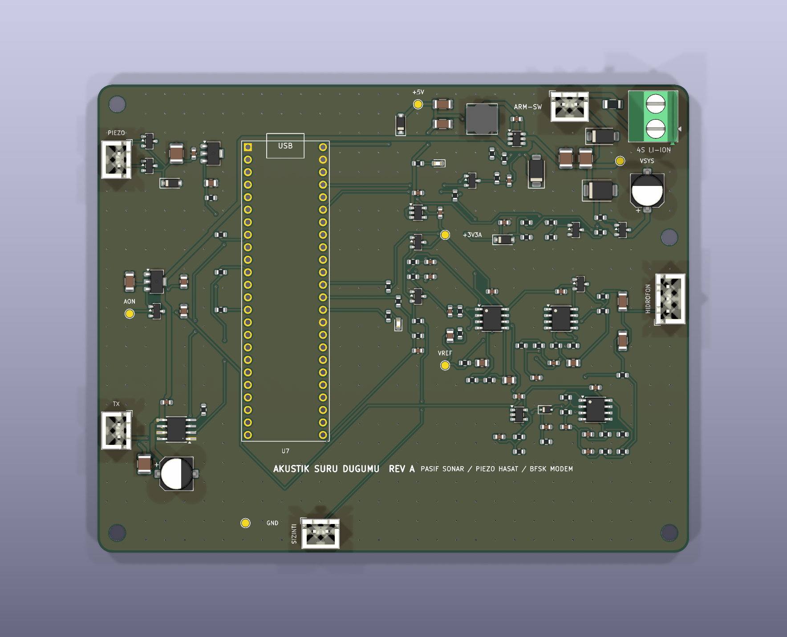
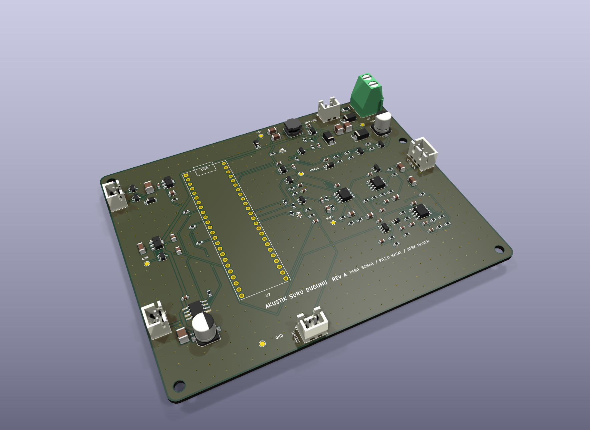
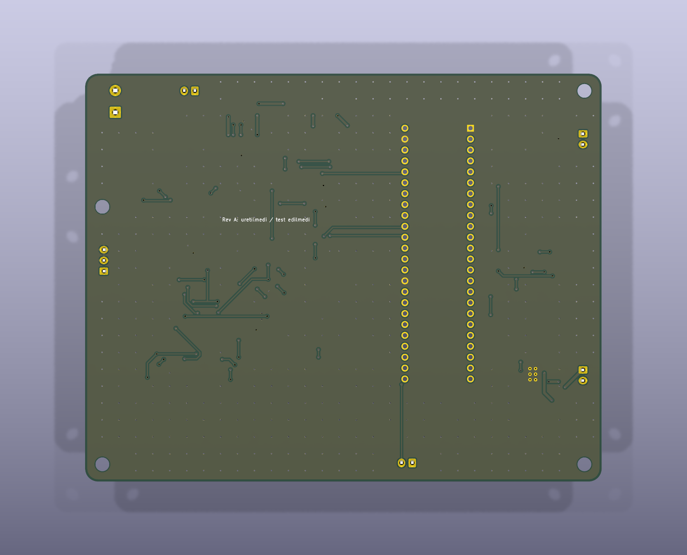
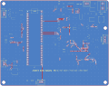

# Akustik Suru Dugumu Karti (Rev A)

Teensy 4.1 tabanli pasif akustik dinleme / akustik modem dugumu icin 2 katmanli (120x95 mm, FR-4, 1.6 mm, 1 oz bakir) PCB tasarimi. Rev A tasarim asamasindadir; uretilmedi ve test edilmedi.

| Ust yuz | Izometrik |
| --- | --- |
|  |  |

| Alt yuz (GND dokumu) | Bakir + silkscreen yerlesimi |
| --- | --- |
|  |  |

Gorseller KiCad 9 3B goruntuleyicisinden (`kicad-cli pcb render`) uretilmistir; Teensy 4.1 soketi icin 3B model olmadigindan sadece header pedleri gorunur.

Kartin cozdugu temel elektriksel noktalar:

- Uykuda Teensy, AFE ve modem tamamen enerjisiz; yalnizca ~7 uA'lik hep acik alan (`HT7533-1` + `MCP6042` 60 dB uyanma yukselteci + `TLV7031` karsilastirici) hidrofonu dinler ve `LMR16006X` buck'in `EN` pinini surer. Teensy acilinca `PWR_HOLD` (pin 23) ile kendi beslemesini tutar.
- Hidrofon AFE'si: 20 dB on yukseltec, 39.7 kHz Sallen-Key anti-aliasing filtresi ve 40 dB ikinci kademe. Iki cikis Teensy'nin iki ADC'sinde ayni anda 192 kHz'te orneklenir (cift kazanc, ~80 dB dinamik aralik).
- Piezo dalga/akinti hasadi: `BAT54S` tam dalga kopru, 22 uF depolama, 18 V kiskac ve ikinci `HT7533-1`; `BAT54C` diyot-VEYA ile hep acik alani besler.
- `DRV8871` H-koprusuyle 24/28 kHz BFSK akustik modem vericisi (1 A akim siniri, kullanilmadiginda < 1 uA uyku).
- Uykuda sifir akim ceken anahtarli pil olcumu (`AO3401A` + `2N7002`), seri NC reed kurma anahtari, 2 A sigorta, ters kutup ve TVS korumasi.

## Dizin Yapisi

- `DESIGN.md`: Devre hesaplari, akim butcesi, AFE ve baglanti butcesi, PCB kurallari, devreye alma.
- `WIRING.md`: Konnektor ve Teensy 4.1 pin eslemesi.
- `acoustic-swarm-node/`: KiCad proje, sematik ve PCB dosyalari.
- `output/`: Gerber + delik paketi, BOM, CPL (pick-and-place), sematik PDF ve DRC raporu.
- `images/`: 3B render ve yerlesim gorselleri.
- `gen/`: Tek kaynak netlist (`design.py`) uzerinden sematik ve PCB'yi ureten Python betikleri.

Yeniden uretmek icin (KiCad 9, `kiutils`, `numpy`, `scipy`):

```bash
cd hardware/gen
python3 build.py
```

Linux disinda KiCad yollari ortam degiskenleriyle verilir:

```bash
KICAD_SHARE="C:/Program Files/KiCad/9.0/share/kicad" KICAD_CLI="C:/Program Files/KiCad/9.0/bin/kicad-cli.exe" \
  "C:/Program Files/KiCad/9.0/bin/python.exe" build.py
```
